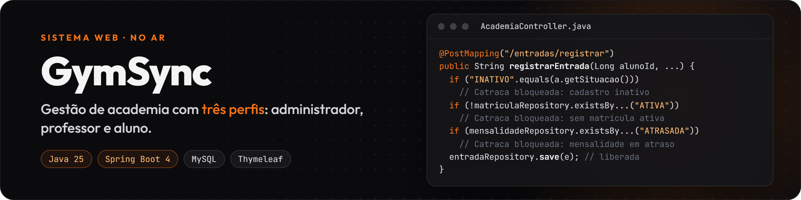
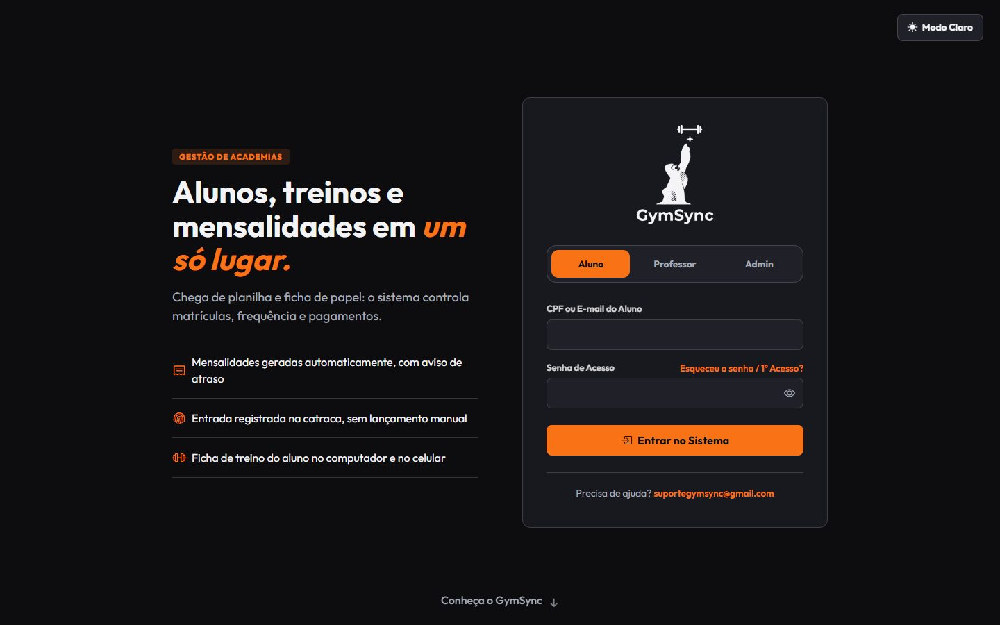
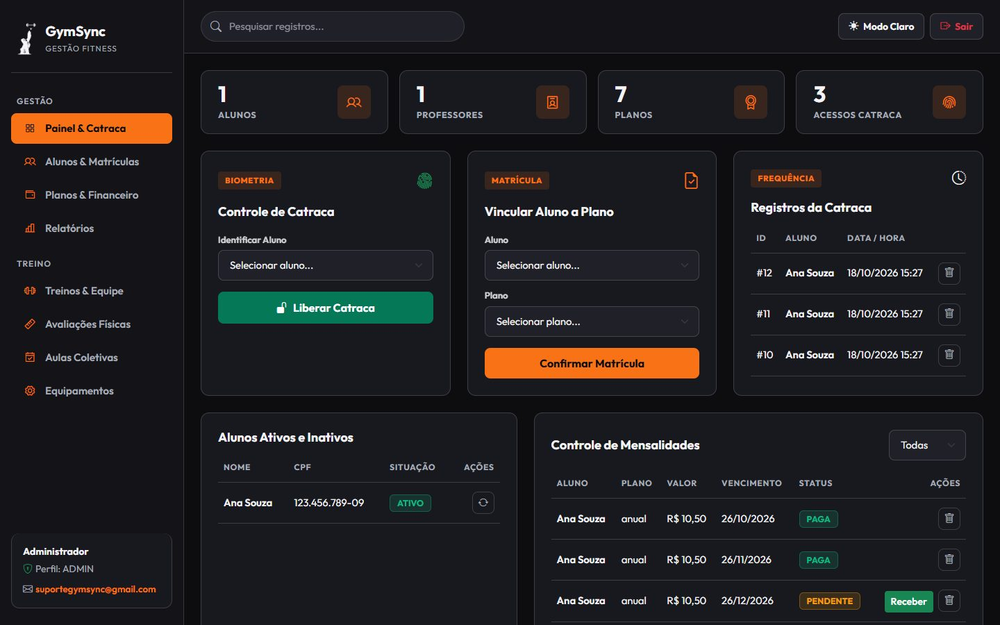
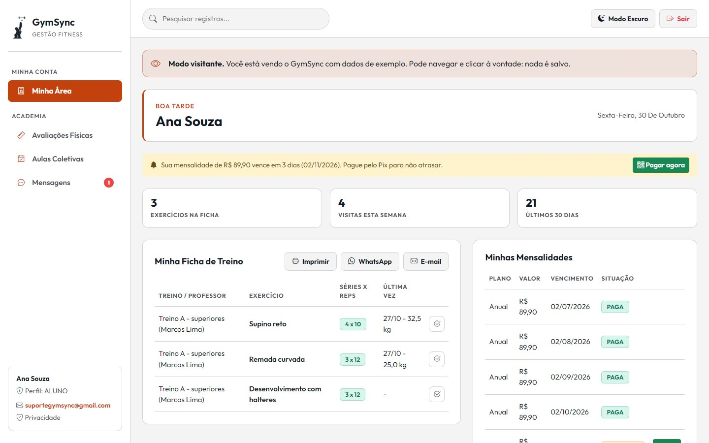
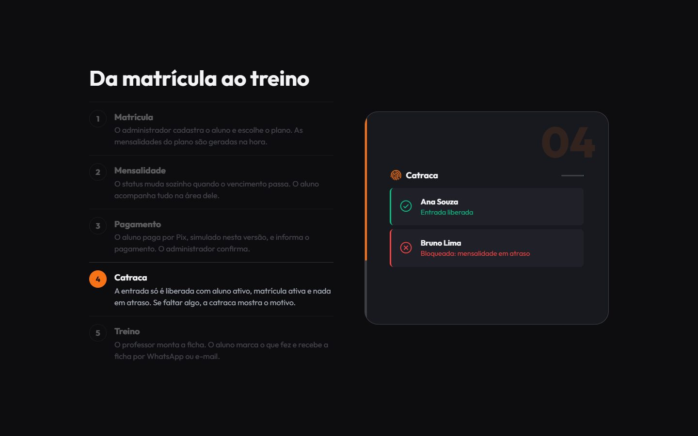
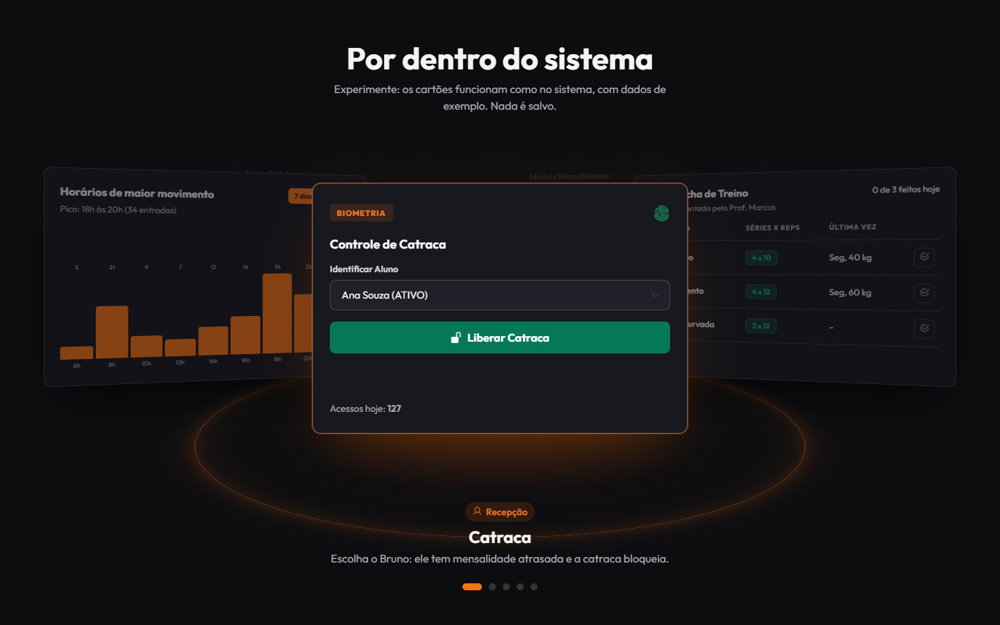
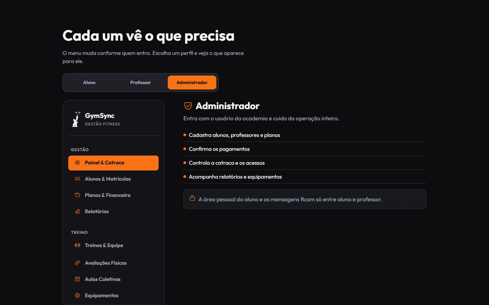
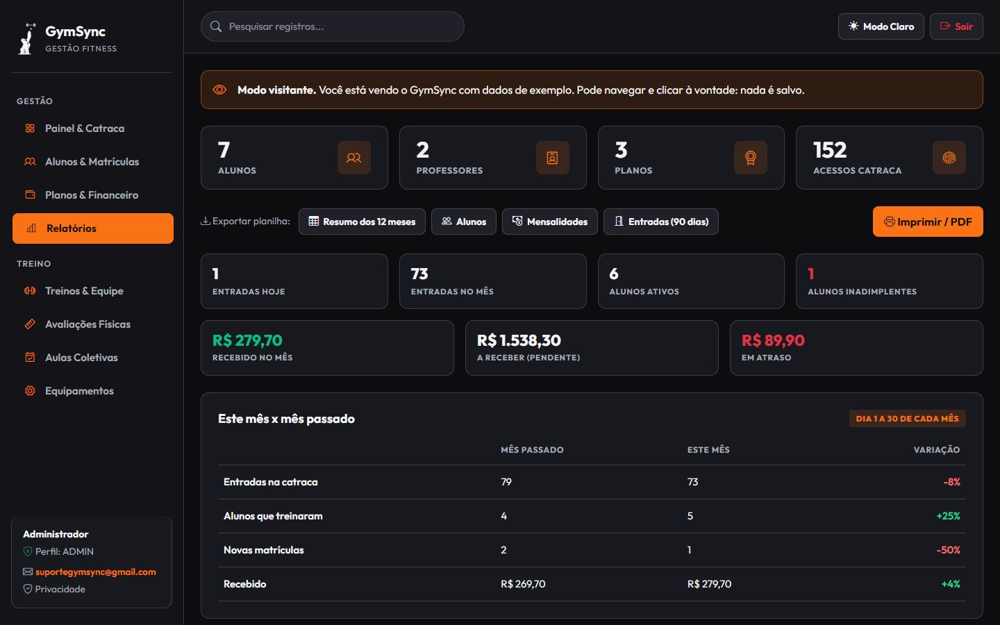
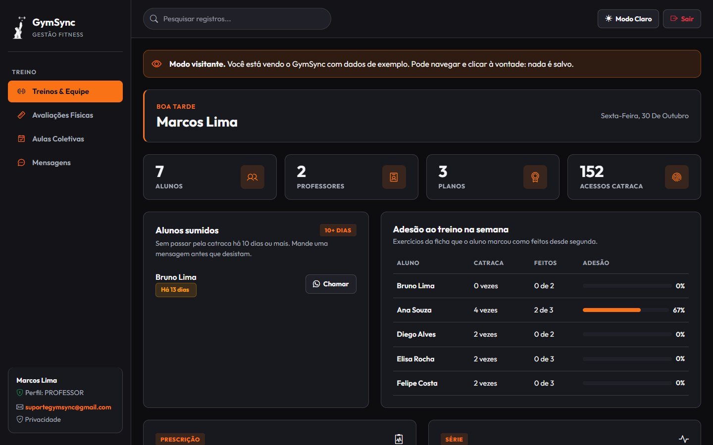
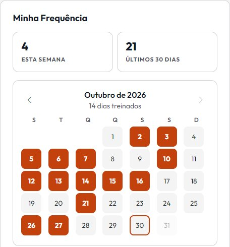

Sistema web de gestão de academias feito em **Java com Spring Boot**: cadastros, planos, matrículas, mensalidades com Pix simulado, catraca, fichas de treino, avaliações físicas, aulas coletivas, equipamentos, mensagens e relatórios. Cada pessoa entra com o próprio perfil (administrador, professor ou aluno) e só vê o que é dela.

Desenvolvi este sistema para um trabalho acadêmico do curso de Análise e Desenvolvimento de Sistemas: modelagem, regras de negócio, back-end, telas e testes.

**Experimente agora:** [gymsync-ucfj.onrender.com](https://gymsync-ucfj.onrender.com), com o botão "Testar como visitante" (dados de exemplo, só leitura). O site roda em plano gratuito e dorme sem uso, então a primeira visita pode levar cerca de um minuto para abrir.



## Destaques

- **Regras de negócio que rodam sozinhas.** A matrícula gera todas as mensalidades; a mensalidade vira atrasada quando o vencimento passa; a catraca só libera quem está ativo, com matrícula ativa e nada em atraso, e mostra o motivo quando bloqueia.
- **Acesso por perfil, testado.** O Spring Security separa o que admin, professor e aluno podem abrir, inclusive digitando a URL. Tudo fica bloqueado por padrão, e a regra de cada rota fica em `RegrasAcesso`, com testes automatizados.
- **Página de apresentação interativa.** Abaixo do login fica um "Quem somos" com um halter em 3D (Three.js), animações de rolagem (GSAP) e réplicas das telas do sistema que dá para clicar: liberar a catraca, pagar uma mensalidade, reservar aula.
- **Interface pensada para o dia a dia.** Tema claro e escuro, funciona no computador e no celular e pode ser instalada no celular como app (PWA). As bibliotecas ficam no próprio projeto, então roda offline no computador.
- **Publicado na internet.** Roda no Render (Docker) com MySQL na Aiven, HTTPS, senhas e chaves em variáveis do servidor (nunca no código) e usuário próprio no banco, sem o administrador do serviço.
- **LGPD.** Política de privacidade, aceite do aluno no primeiro acesso e "Baixar meus dados" em JSON.

## Telas

| | |
| :---: | :---: |
|  |  |
| Painel do administrador: indicadores, catraca e mensalidades | Área do aluno no tema claro |
|  |  |
| "Quem somos": halter 3D caindo na frente do título | A jornada da matrícula ao treino, passo a passo |
|  |  |
| Demonstrações clicáveis das telas | O menu que cada perfil enxerga |
|  |  |
| Relatórios: comparação com o mês passado e exportação em planilha | Professor: alunos sumidos e adesão ao treino na semana |
|  | |
| Aluno: calendário com os dias treinados no mês | |

*Os nomes e o CPF nas imagens são de exemplo.*

## Perfis

| Perfil | O que faz |
| :--- | :--- |
| **Administrador** | Cadastra alunos, professores e planos; faz e cancela matrículas; confirma pagamentos; controla a catraca e os equipamentos; acompanha relatórios e avisos, compara o mês com o anterior, exporta planilhas (CSV) e consulta o histórico de ações. |
| **Professor** | Monta e copia fichas de treino; registra avaliações físicas; cria aulas coletivas; vê os alunos sumidos (10 dias ou mais sem catraca) e a adesão ao treino na semana; conversa com os alunos e envia a ficha por WhatsApp ou e-mail. |
| **Aluno** | Vê e imprime o treino e registra a carga; acompanha frequência (calendário), mensalidades e avaliações (evolução); informa pagamentos; reserva aulas; fala com o professor; baixa os próprios dados (LGPD). |

Quem não tem login pode usar o botão **Testar como visitante**: entra com dados de exemplo, só para leitura.

## Regras de negócio

| Assunto | Regra |
| :--- | :--- |
| Planos | O plano guarda o valor total e a duração; a mensalidade é o total dividido pelos meses (a última parcela ajusta os centavos). |
| Matrícula | Gera todas as mensalidades. Não permite duas matrículas ativas nem matricular aluno inativo. |
| Mensalidade | Pendente, atrasada, em análise, paga ou cancelada. Fica atrasada sozinha depois do vencimento. |
| Pagamento | O aluno paga pelo Pix (simulado) e informa; o pagamento fica em análise até o administrador confirmar ou recusar. |
| Catraca | Libera só aluno ativo, com matrícula ativa e sem mensalidade atrasada. Senão, bloqueia e mostra o motivo. |
| Aulas coletivas | A reserva vale para a próxima aula e respeita o limite de vagas. |
| Treinos | Cada professor altera as fichas que criou; o administrador altera todas. |

## Arquitetura

Aplicação MVC com páginas montadas no servidor:

```text
src/main/java/com/example/sistema/academia
├── config       # Spring Security (acesso por perfil, CSRF, CSP), regras de acesso, sessão
├── controller   # login, cadastros e financeiro, treinos, aulas, avaliações, equipamentos, mensagens, privacidade
├── dto          # dados de apoio para as telas (avisos, gráficos, contatos)
├── model        # entidades JPA (alunos, planos, matrículas, mensalidades, treinos, aulas, histórico etc.)
├── repository   # Spring Data JPA (consultas derivadas do nome do método)
├── service      # situação das mensalidades, avisos, relatórios, frequência, evolução, exclusão em cascata, ficha, recuperação de senha
├── util         # validação de CPF, e-mail e telefone
└── view         # formatação de dinheiro, datas e status para os templates
```

- **Telas:** Thymeleaf com fragmentos (`templates/fragments`), Bootstrap 5, CSS e JavaScript próprios em `static/`.
- **Banco:** MySQL; as tabelas são criadas e atualizadas pelo Hibernate, e o banco `academia_db` é criado na primeira execução.
- **Front-end da apresentação:** GSAP + ScrollTrigger, Three.js e Phosphor Icons, todos guardados no projeto para funcionar sem internet.

## Segurança

O que já existe:

- Spring Security: tudo bloqueado por padrão, proteção CSRF e Content Security Policy rígida.
- Senhas guardadas com BCrypt; senhas fortes opcionais.
- Limite de tentativas de login (bloqueio temporário por conta e por IP).
- Recuperação de senha por link de uso único enviado por e-mail (opcional).
- Ações que alteram dados só por `POST`, com confirmação antes de excluir.
- Validação dos dados também no servidor, e campos aceitos limitados no cadastro.
- Sessão só por cookie; senha do banco fora do repositório (`application.properties` no `.gitignore`).
- Política de privacidade e aceite do aluno no primeiro acesso.

Publicado na internet com HTTPS pela plataforma de hospedagem.

## Como rodar

**Pré-requisitos:** JDK 25, MySQL 8 ligado e Git. O Maven já vem no projeto (Maven Wrapper).

```bash
git clone https://github.com/PedroFerrari01/GymSync.git
cd GymSync
```

1. Em `src/main/resources`, copie `application.properties.example` para `application.properties` e coloque a senha do seu MySQL em `spring.datasource.password`.
2. Rode:
   - Windows: `.\mvnw.cmd spring-boot:run`
   - Linux/macOS: `./mvnw spring-boot:run`
3. Abra `http://localhost:8080` quando aparecer `Started SistemaAcademiaApplication`.

**Acesso de teste:** administrador `admin` / `123`. Professores e alunos entram com o CPF ou e-mail cadastrado pelo administrador e a senha inicial `123`. Para cadastrar, use CPFs válidos (o sistema confere os dígitos).

**Testes de acesso** (não precisam do banco):

```bash
./mvnw test -Dtest=RegrasAcessoTest,LimiteTentativasServiceTest,SenhaServiceTest,AuthControllerTest,CamposPermitidosTest,VisitanteServiceTest,FrequenciaServiceTest,EvolucaoServiceTest,AvisoVencimentoTest,AcompanhamentoServiceTest,ExportacaoServiceTest,SituacaoServiceTest,HistoricoConfigTest
```

São 88 testes; não precisam do banco. `SistemaAcademiaApplicationTests` precisa do MySQL ligado.

| Erro | Solução |
| :--- | :--- |
| `Communications link failure` | O MySQL não está ligado. |
| `Access denied for user 'root'` | A senha no `application.properties` não confere com a do MySQL. |
| `Public Key Retrieval is not allowed` | Acrescente `&allowPublicKeyRetrieval=true` na URL do banco. |
| `Port 8080 was already in use` | Já existe outra execução aberta; feche-a ou mude `server.port`. |

## Próximos passos

- [x] Spring Security, CSRF e limite de tentativas de login
- [x] Recuperação de senha por e-mail
- [x] Publicação na nuvem e aplicativo para o aluno (PWA)
- [ ] Pagamento real (Pix ou cartão) com um provedor de pagamento
- [ ] Avisos por e-mail ou WhatsApp e chat em tempo real
- [ ] Leitor biométrico e catraca de verdade
- [ ] Rodar os testes automaticamente a cada envio (GitHub Actions)
- [ ] Testes de integração com o banco de dados
- [ ] Varredura de segurança com o OWASP ZAP e correção do que aparecer

## Autoria

Desenvolvido por **Pedro Ferrari** ([GitHub](https://github.com/PedroFerrari01) · [LinkedIn](https://www.linkedin.com/in/pedrohpferrari/)): modelagem, regras de negócio, back-end, telas e testes.

O trabalho acadêmico foi feito em grupo: os colegas contribuíram com ideias, a proposta, o canvas e os slides da apresentação.

A página de apresentação "Quem somos" (halter 3D, animações e demonstrações) foi feita com apoio de IA.
